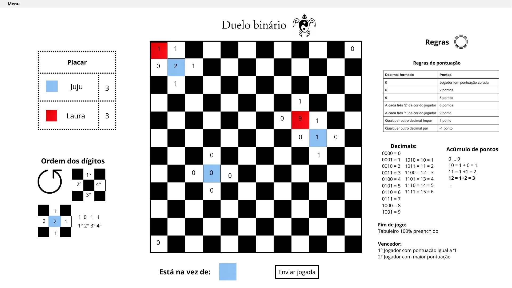

# Duelo Binário

> Um jogo estratégico de lógica binária para dois jogadores, desenvolvido em Python com interface gráfica Tkinter.

## Visão Geral

### Tabuleiro Principal



O **Duelo Binário** é um desafio lógico que combina estratégia e matemática binária. Os jogadores competem em um tabuleiro xadrez 12x12, inserindo dígitos binários (0 e 1) para formar números decimais e acumular pontos. O objetivo é finalizar a partida com pontuação igual a 1 ou obter a maior pontuação possível.

## ⚙️ Requisitos

- Python 3.10 ou superior
- Tkinter (interface gráfica)

## Instalação e Execução

### 1️⃣ Criar e ativar ambiente virtual (apenas para versão online)

```bash
python -m venv env
```

**No Linux/macOS:**
```bash
source env/bin/activate
```

**No Windows:**
```cmd
env\Scripts\activate
```

### 2️⃣ Instalar Tkinter

**No Linux:**
```bash
sudo apt install python3-tk
```

**No Windows:** Tkinter geralmente já vem instalado com Python.

**No macOS:**
```bash
brew install python-tk
```

### 3️⃣ Executar o jogo

Na pasta `src`, execute:

```bash
python3 main.py <modo>
```

Substitua `<modo>` por `1` ou `2`:
- **Modo 1**: Ambos os jogadores usam a mesma máquina (recomendado)
- **Modo 2**: Usa o servidor DOG para jogo remoto (instável)

> ⚠️ **Nota:** Este programa foi testado e funciona bem em sistemas Linux e Windows. Não recomendamos seu uso no macOS devido à instabilidade.

## 🎮 Como Jogar

### Elementos do Jogo

1. **Placar**: Exibe nome e pontuação atual dos jogadores
2. **Tabuleiro**: Área de jogo 12x12 com casas brancas e pretas
3. ** Indicador de jogador ativo**: Mostra quem deve jogar
4. ** Botão "Enviar jogada"**: Confirma a jogada do jogador

### Significado das Casas

As 4 casas brancas ao redor de cada casa preta representam as 4 posições de um número binário:
- **⬆️ Casa superior**: Bit mais significativo (posição 8)
- **⬅️ Casa esquerda**: 2º bit mais significativo (posição 4)
- **⬇️ Casa inferior**: 3º bit mais significativo (posição 2)
- **➡️ Casa direita**: Bit menos significativo (posição 1)

### Dinâmica das Jogadas

1. ** Inserir dígitos**: Em cada turno, escolha inserir '0' ou '1' em uma casa branca vazia
   - ** Clique esquerdo**: Insere '0'
   - ** Clique direito**: Insere '1'

2. ** Confirmar jogada**: Clique em "Enviar jogada" para finalizar seu turno

3. ** Pontuação**: Quando as 4 casas brancas ao redor de uma casa preta estão preenchidas:
   - O número decimal correspondente ao binário é inserido na casa preta
   - A casa preta adquire a cor do jogador que completou o número
   - Pontos são atribuídos conforme as regras de pontuação

###  Regras de Pontuação

| Decimal Formado | Pontos |
|----------------|--------|
| 0 | Pontuação zerada |
| 6 | 2 pontos |
| 9 | 3 pontos |
| A cada três '2' da cor do jogador | 6 pontos |
| A cada três '1' da cor do jogador | 9 pontos |
| Qualquer outro decimal ímpar | 1 ponto |
| Qualquer outro decimal par | -1 ponto |

###  Formação de Decimais

Para números binários de 10 a 15, soma-se os dígitos do decimal:

|  Binário |  Decimal |  Soma dos Dígitos |  Decimal Final |
|------------|------------|-------------------|----------------|
| 1010       | 10         | 1 + 0 = 1        | **1**          |
| 1011       | 11         | 1 + 1 = 2        | **2**          |
| 1100       | 12         | 1 + 2 = 3        | **3**          |
| 1101       | 13         | 1 + 3 = 4        | **4**          |
| 1110       | 14         | 1 + 4 = 5        | **5**          |
| 1111       | 15         | 1 + 5 = 6        | **6**          |

###  Acúmulo de Pontos

A pontuação máxima é **9**. Quando ultrapassar 9, soma-se os dígitos do resultado:
- **Exemplo 1**: 8 + 2 = 10 → 1 + 0 = **1 ponto final**
- **Exemplo 2**: 9 + 3 = 12 → 1 + 2 = **3 pontos finais**

### 🏁 Encerramento

O jogo termina quando todas as casas brancas estão preenchidas.

**🏆 Vence quem:**
1. 🥇 Finalizar com pontuação igual a **1**, OU
2. 🥈 Obter a **maior pontuação**

##  Modos de Jogo

###  Modo 1 (Local - Recomendado)
-  Ambos os jogadores alternam turnos no mesmo dispositivo
-  Experiência fluida e sem delays
-  Ideal para aprendizado e partidas casuais

###  Modo 2 (Servidor DOG)
-  Conecta ao servidor DOG para jogo remoto
-  Pode apresentar delays e instabilidade
-  Um jogador deve clicar em "Iniciar partida" no menu
-  Aguardar conexão de ambos os jogadores

##  Filosofia: A Numerologia do Duelo Binário

> *"No jogo dos números, encontramos os mistérios do universo"*

O **Duelo Binário** transcende a mera competição estratégica, incorporando princípios profundos da numerologia e filosofia oriental que ecoam a sabedoria milenar do **I Ching**.

### ☯️ A Dualidade Fundamental (0 e 1)

Os dígitos básicos do jogo representam a dualidade universal presente em todas as tradições orientais:
- **  (Zero)**: O vazio criativo, o potencial não manifestado, o **Yin**
- ** 1 (Um)**: A unidade primordial, a força manifestadora, o **Yang**

Esta dualidade binária reflete o princípio fundamental do **I Ching**, onde todas as situações da vida podem ser compreendidas através da interação entre forças opostas e complementares.

###  Os Números Sagrados e seus Significados

#### ** 1 - A Meta Suprema**
Na filosofia hindu e no I Ching, o número **1** representa a unidade com o divino, a realização espiritual. No jogo, obter pontuação **1** é a vitória máxima - simbolizando que o verdadeiro triunfo não está no acúmulo material, mas na conquista da harmonia e simplicidade.

#### ** 2 - A Dualidade em Equilíbrio**
O número **2** no jogo vale pontos especiais quando acumulado em três casas (6 pontos). Isso reflete o conceito taoísta de que a dualidade, quando compreendida em sua totalidade (3 sendo o número da completude), gera abundância espiritual.

#### ** 6 - A Harmonia Material**
Com 2 pontos diretos, o **6** representa a harmonia no mundo material. Na numerologia, 6 é o número da responsabilidade, família e equilíbrio terreno - uma recompensa sólida mas não transcendental.

#### ** 9 - A Sabedoria Completa**
O número **9**, valendo 3 pontos, é considerado o número da sabedoria completa na tradição hindu. É o último dígito simples, representando a culminação do conhecimento antes do retorno à unidade (10 → 1+0 = 1).

### 🔄 A Lei do Retorno Cíclico

O sistema de pontuação que reduz números superiores a 9 pela soma de seus dígitos (10→1, 11→2, etc.) reflete o conceito oriental de **ciclos eternos** - o Samsara hindu e o conceito de retorno do I Ching. Nada se perde, tudo se transforma e retorna à essência.

###  A Estratégia como Caminho Espiritual

Cada jogada no Duelo Binário é uma meditação sobre:
- ** Escolha consciente**: Decidir entre 0 e 1 é decidir entre potencial e manifestação
- ** Consequências interconectadas**: Uma casa branca afeta quatro casas pretas, simbolizando como nossas ações reverberam no cosmos
- ** Paciência estratégica**: A necessidade de esperar o momento certo ecoa os ensinamentos sobre timing divino no I Ching

###  O Zero como Renovação

No jogo, obter **0** zera a pontuação - não como punição, mas como oportunidade de recomeço. Na filosofia oriental, o vazio não é ausência, mas **potencial infinito**. É o convite para um novo ciclo, uma nova oportunidade de crescimento.

###  Conclusão Filosófica

O **Duelo Binário**, em sua essência, é um microcosmo da existência humana: navegamos entre polaridades (0 e 1), buscamos o equilíbrio (pontuação estratégica), e aspiramos à transcendência (alcançar o 1 como vitória suprema). Cada partida é uma jornada filosófica onde a verdadeira vitória não está apenas em derrotar o oponente, mas em compreender os padrões universais que governam tanto o jogo quanto a vida.

## 🛠️ Suporte Técnico

Para problemas técnicos ou dúvidas sobre o jogo, verifique:

1. ✅ Se a versão do Python é compatível (3.10+)
2. ✅ Se o Tkinter está corretamente instalado
3. ✅ Se você está executando o comando na pasta correta (`src`)

> ⚠️ **Nota importante sobre o Servidor DOG:** O Modo 2 utiliza conexão de servidor que pode apresentar delays e instabilidade, impactando a experiência de jogo. Para melhor experiência, use o Modo 1.

---

<div align="center">

### 👨‍💻 Desenvolvimento

**Design de produto:** Rita Louro Barbosa
**Desenvolvedores:** Rita Louro Barbosa • Henrique Afonso Alves de Lima** • Thiago Kenzo Takahashi**

---

* Que cada partida seja uma jornada de descoberta e crescimento! *

</div>